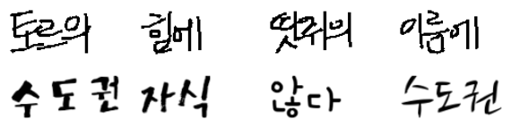

# Рукописный ввод корейского: исследование

Цель — упражнение, в котором ученик пишет корейское слово пальцем на экране, а приложение проверяет ответ **без сети**. Исследование не меняет код приложения; стенд и сырые результаты — в [labs/handwriting](../labs/handwriting).

## Коротко

- **Рекомендация:** открытая модель `korean-handwriting-rec` (PP-OCRv5, дообученная на рукописном хангыле), 14,8 МБ ONNX, Apache-2.0. Она запускается тем же ONNX Runtime, что уже есть в приложении для озвучки, — новых нативных библиотек не нужно.
- **Наш случай проще общего распознавания.** В упражнении известен правильный ответ, поэтому модель не «читает что угодно», а отвечает на вопрос «написано ли это слово?». В таком режиме она принимает **98,9–99,9 %** правильно написанных слов, пропуская не больше 1 % почти правильных ответов (одна буква не та), если почерк аккуратный, и **89 %** — на быстром скорописном почерке носителя.
- **Скорость:** ≈7 мс на слово на одном ядре сервера; на телефоне ожидаемо 20–40 мс — незаметно.
- **ML Kit от Google** точнее на «любом» тексте, но это закрытая библиотека, модели скачиваются с серверов Google, а условия их использования нужно проверять отдельно; для бесплатного офлайн-приложения без телеметрии открытая модель предпочтительнее.

## Варианты

| Вариант | Размер | Лицензия | Сеть | Комментарий |
|---|---|---|---|---|
| **korean-handwriting-rec** (PP-OCRv5, дообучена на рукописи) | 14,8 МБ | Apache-2.0 (модель); обучена на данных AI Hub | нет | ONNX, тот же ONNX Runtime; рекомендуется |
| korean_PP-OCRv5_mobile_rec (базовая) | 13,4 МБ | Apache-2.0 | нет | обучена в основном на печатном тексте; заметно хуже на рукописи |
| Google ML Kit Digital Ink | ≈20 МБ на язык + библиотека | проприетарная | модель скачивается с серверов Google | распознаёт штрихи напрямую; закрытая зависимость |
| Своя модель с нуля | — | — | нет | нет большого открытого набора штрихов хангыля: один открытый набор — 1 автор, CC BY-SA |
| Рукописная клавиатура телефона (Samsung, Gboard) | 0 | — | — | уже работает в поле ввода, но автозамена подсказывает ответ, а проверить само написание нельзя |

## Как проверяли

Штрихи превращаются в картинку тонкой линией, как палец на экране, и подаются в модель — ровно так будет работать приложение.

- **Настоящий почерк:** 1 500 слов из открытого набора штрихов пера ([jbaudanza/korean-handwriting-strokes](https://huggingface.co/datasets/jbaudanza/korean-handwriting-strokes), CC BY-SA 4.0). Ограничение: **один автор**, носитель языка, пишет быстро и связно, слова из Википедии.
- **Аккуратный почерк:** 150 учебных слов уровней 1–2 из нашего словаря, нарисованные 10 рукописными шрифтами разного стиля (1 500 картинок). Ближе к тому, как пишет ученик, но это шрифты, а не живые люди.

## Результаты

### Открытое распознавание (модель читает что угодно)

| | Базовая, слово целиком | Базовая, ошибок в буквах | Рукописная, слово целиком | Рукописная, ошибок в буквах |
|---|---|---|---|---|
| Настоящий почерк, слова | 35,8 % | 35,7 % | **63,6 %** | 15,5 % |
| Настоящий почерк, строки | 6,3 % | 32,0 % | 17,3 % | 16,6 % |
| Аккуратный почерк, учебные слова | 96,5 % | 1,9 % | **98,8 %** | 0,5 % |

Для поиска в словаре «от руки» этого хватает на аккуратном почерке, но не на скорописи.

### Проверка ожидаемого ответа (наше упражнение)

Ответ принимается, если модель прочитала ровно ожидаемое слово **или** ожидаемое слово получает достаточно высокую оценку модели (CTC-потеря на символ ниже порога). Порог подобран так, чтобы неверный ответ проходил не чаще 1 % (или 5 %).

**Неверный ответ — почти правильное слово** (одна буква заменена похожей: 학고 вместо 학교, 선생닌 вместо 선생님; это самые частые ошибки ученика):

| | Базовая, 1 % | Базовая, 5 % | Рукописная, 1 % | Рукописная, 5 % |
|---|---|---|---|---|
| Настоящий почерк | 56,2 % | 72,3 % | **89,3 %** | 92,8 % |
| Аккуратный почерк | 98,5 % | 99,1 % | **99,9 %** | 99,9 % |

Доля правильно написанных слов, которые принимаются, при заданной доле пропущенных неверных.

**Неверный ответ — другое слово той же длины:** рукописная модель принимает 97,7 % правильных (настоящий почерк) и 100 % (аккуратный) при 1 % пропущенных неверных.

**Самое строгое правило** — «принять, только если модель прочитала ровно это слово»: почти правильные ответы проходят в 0,02–0,07 % случаев, но правильные принимаются лишь в 64 % (скоропись) и 98 % (аккуратно).

### Скорость и размер

| | Размер | Время на слово (1 поток CPU сервера) |
|---|---|---|
| Базовая | 13,4 МБ | медиана 7,0 мс, 90 % — до 10,5 мс |
| Рукописная | 14,8 МБ | медиана 6,8 мс, 90 % — до 10,6 мс |

## Ограничения

- **Нет данных от учеников.** Настоящий почерк — один носитель; аккуратный — шрифты. Как пишут начинающие пальцем на телефоне (крупно, медленно, иногда с неверным порядком черт), мы не знаем — это первое, что нужно проверить на ваших телефонах.
- **Модель смотрит на картинку, а не на порядок черт.** Неправильный порядок или направление черт она не заметит. Обучать порядку черт — отдельная задача на потом.
- **Данные AI Hub.** Модель опубликована под Apache-2.0, но дообучена на данных AI Hub, у которых свои условия использования. Для бесплатного некоммерческого приложения риск невелик, но условия стоит прочитать до выпуска; запасной вариант — базовая модель (чистый Apache-2.0) с проверкой ответа: на аккуратном почерке она тоже принимает 98,5 %.
- **Порог подобран на этих наборах.** На живых данных учеников его нужно будет подстроить.

## Как встроить (предложение)

1. **H1 — лабораторный экран.** Холст для рисования и проверка «написано ли это слово» прямо на телефоне, с показом прочитанного текста и оценки. Собираем 50–100 своих попыток на каждом телефоне, подстраиваем порог. Только после этого — упражнение.
2. **H2 — нативный холст.** Свой Android View в модуле `namu-tts` (или отдельном): он рисует штрихи без задержек, а по кнопке «Проверить» сам превращает их в картинку 48 px и запускает модель. JavaScript получает только результат — дорогих передач точек через мост нет. Кнопки «Стереть» и «Отменить черту».
3. **H3 — модель как скачиваемый пакет** в namu-voices (≈15 МБ) с проверкой SHA-256 и согласием пользователя — так же, как голос и озвучка словаря; APK не растёт, модель можно обновлять.
4. **H4 — упражнение.** Способ ответа `handwriting` уже заложен в ядре (`EXERCISES.handwriting`, навык `writing`, направление «перевод → корейский»): включаем его, проверка — по правилу выше. Если ответ не принят, показываем, что прочитала модель, и правильное написание, с кнопкой «Я написал правильно» — как для синонимов при вводе перевода. Отдельная статистика «Письмо» уже есть.
5. **H5 — проверка на устройствах:** точность на своём почерке, время, память, работа без сети, отсутствие модели (способ ответа просто недоступен).

## Источники

- [VerifiedIdiot/korean-handwriting-rec](https://github.com/VerifiedIdiot/korean-handwriting-rec) — рукописная модель, Apache-2.0
- [PaddlePaddle/korean_PP-OCRv5_mobile_rec](https://huggingface.co/PaddlePaddle/korean_PP-OCRv5_mobile_rec), ONNX: [monkt/paddleocr-onnx](https://huggingface.co/monkt/paddleocr-onnx)
- [jbaudanza/korean-handwriting-strokes](https://huggingface.co/datasets/jbaudanza/korean-handwriting-strokes) — штрихи пера, CC BY-SA 4.0
- [ML Kit Digital Ink Recognition](https://developers.google.com/ml-kit/vision/digital-ink-recognition/android) — ≈20 МБ на язык, модели скачиваются по запросу
- Рукописные шрифты: [google/fonts](https://github.com/google/fonts), SIL OFL 1.1
